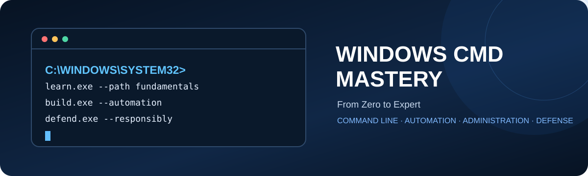
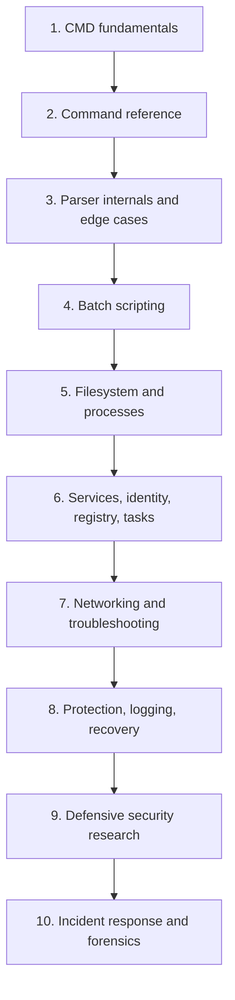

<div align="center">
  

  <h1>Windows CMD Mastery</h1>
  <p><strong>From Zero to Expert Windows Administration, Automation, Internals & Defensive Security Research</strong></p>
  <p>A structured learning library for CMD, batch scripting, Windows operations, and defensive security research.</p>

  
  
  
  
</div>

---

## Navigate the repository

| Start here | What you'll find |
|---|---|
| [Getting Started](docs/getting-started.md) | How to use the guides and books |
| [Learning Roadmap](docs/learning-roadmap.md) | A staged beginner-to-advanced path |
| [Three-Volume Library](books/README.md) | PDF downloads and chapter maps |
| [Topic Index](docs/index.md) | Find material by subject |
| [Command Index](docs/command-index.md) | Navigate command-reference coverage |
| [Lab Index](labs/README.md) | Source lab ranges and safe practice guidance |
| [Lab Safety](docs/lab-safety.md) | Isolated environments, snapshots, cleanup |
| [Troubleshooting Guide](docs/troubleshooting.md) | A careful first-pass diagnostic workflow |
| [Glossary](docs/glossary.md) | Key terms used across the volumes |
| [References](docs/references.md) | Source notes and verification guidance |

## Why this project exists

Windows CMD is still useful for understanding command-line behavior, maintaining legacy scripts, automating routine tasks, and investigating Windows systems. This repository organizes the **three supplied Windows CMD Mastery volumes** into a navigable study library, with a roadmap and source-aware indexes alongside the original PDFs.

The PDF manuscripts remain the primary source for their chapters, command cards, and lab numbering. The Markdown pages in this repository are navigation aids and supplementary notes; they do not replace the books or imply that every topic has been independently retested.

## What you'll learn

- **Command-line foundations:** prompts, paths, environment variables, streams, exit status, and basic commands.
- **CMD behavior:** parsing, expansion, operators, redirection, pipes, lookup order, quoting, and edge cases.
- **Batch automation:** arguments, control flow, subroutines, logging, validation, and maintainable script patterns.
- **Windows administration:** NTFS and permissions, processes, services, access tokens, registry, scheduled tasks, networking, firewall, event logs, Defender, recovery, and performance.
- **Defensive security:** command-line telemetry, safer batch design, PATH hardening, incident response, and evidence handling.

## The three-volume library

<table>
<thead><tr><th>Volume</th><th>Coverage</th><th>Best starting point</th></tr></thead>
<tbody>
<tr><td><strong><a href="books/Windows_CMD_Mastery_Volume1.pdf">Volume 1 — Fundamentals, Command Reference & Batch Scripting</a></strong></td><td>Parts I–V; chapters 1–21; foundational labs and command lookup.</td><td>New learners and anyone who wants to understand CMD itself.</td></tr>
<tr><td><strong><a href="books/Windows_CMD_Mastery_Volume2.pdf">Volume 2 — Advanced Windows Administration</a></strong></td><td>Parts VI–XVIII; chapters 21–43; filesystem, processes, services, identity, registry, tasks, networking, protection, recovery, and performance.</td><td>Learners with basic command-line familiarity.</td></tr>
<tr><td><strong><a href="books/Windows_CMD_Mastery_Volume3.pdf">Volume 3 — Defensive Security Research</a></strong></td><td>Parts XIX–XXIII; chapters 44–58; telemetry, command injection prevention, path security, incident response, and forensics.</td><td>Advanced learners working in authorized, isolated labs.</td></tr>
</tbody></table>

More exact chapter lists and lab ranges are in the [book library page](books/README.md). The volumes' page numbers refer to the printed page numbers within each PDF.

## Learning roadmap



Use the [detailed roadmap](docs/learning-roadmap.md) for chapter references and completion goals.

## Topic navigation

| Topic | Repository guide | Source coverage |
|---|---|---|
| Fundamentals | [CMD fundamentals](guides/fundamentals/README.md) | Volume 1, Parts I–II |
| Command reference | [Command reference guide](guides/command-reference/README.md) | Volume 1, Chapters 4–9; indexes in all volumes |
| Parser and edge cases | [Parser internals](guides/parser-internals/README.md) | Volume 1, Parts III–IV |
| Batch scripting | [Batch scripting](guides/batch-scripting/README.md) | Volumes 1–2; labs continue in Volume 3 |
| Filesystem | [Filesystem and permissions](guides/filesystem/README.md) | Volume 2, Part VII |
| Processes and services | [Processes and services](guides/processes-and-services/README.md) | Volume 2, Parts VIII–IX |
| Registry and tasks | [Registry and scheduled tasks](guides/registry-and-tasks/README.md) | Volume 2, Parts XI–XII |
| Networking | [Networking](guides/networking/README.md) | Volume 2, Part XIII |
| Administration | [Windows administration](guides/administration/README.md) | Volume 2, Parts XIV–XVIII |
| Troubleshooting | [Troubleshooting workflow](docs/troubleshooting.md) | Volume 2, Chapters 34 and 38–39 |
| Defensive security | [Defensive security](guides/defensive-security/README.md) | Volume 3, Parts XIX–XXI |
| Incident response | [Incident response](guides/incident-response/README.md) | Volume 3, Part XXII |
| Forensics | [Command-line forensics](guides/forensics/README.md) | Volume 3, Part XXIII |

## Command references

Use the [command index](docs/command-index.md) to jump into the books' command cards and indexes. It is an index into the source material, not a claim that every command has a separate Markdown page. Keep CMD syntax distinct from PowerShell syntax when adding examples.

## Quick start on Windows 10/11

1. Download or clone this repository.
2. Open `README.md` and start with [Getting Started](docs/getting-started.md).
3. Read Volume 1 in order if you're new to CMD.
4. Create a scratch folder for practice and use harmless test files only.
5. Review [Lab Safety](docs/lab-safety.md) before state-changing exercises.

To clone after publishing under your own GitHub account, replace the placeholder with your actual repository URL:

```text
git clone https://github.com/YOUR-USERNAME/Windows-CMD-Mastery.git
cd Windows-CMD-Mastery
```

The URL above is an example pattern, not a live repository link.

## A first CMD session

Open **Command Prompt** (`cmd.exe`) and try these read-only or low-impact commands one at a time:

```bat
ver
cd
whoami
help
```

| Command | Purpose |
|---|---|
| `ver` | Shows the Windows version string reported by CMD. |
| `cd` | Shows the current directory when used without a path. |
| `whoami` | Displays the current account identity. |
| `help` | Lists built-in CMD commands and brief help text. |

Examples are illustrative; output varies across Windows versions, account context, and system configuration. They are not a substitute for the source books' command cards.

## Practical labs

The source manuscripts use objectives, prerequisites, expected results, cleanup, and safety callouts. Preserve that discipline when practicing. The [lab index](labs/README.md) maps the lab-number ranges stated by the PDFs; it does not invent descriptions for individual lab IDs that have not been indexed here.

**Rule of thumb:** use a disposable VM snapshot for any lab that changes configuration, security settings, disks, boot data, or encryption state. Do not run unfamiliar commands against a production or personal system just to see what happens.

## Repository structure

```text
Windows-CMD-Mastery/
├── README.md
├── assets/                 # GitHub-friendly SVG banner
├── books/                  # Original three-volume PDFs
├── docs/                   # Roadmap, indexes, safety, FAQ, glossary
├── guides/                 # Topic-based navigation pages
├── examples/               # Small, benign examples
├── labs/                   # Source lab-number map and templates
├── templates/              # Lab report and review templates
├── scripts/                # Local documentation validation
└── .github/                # Issue/PR templates and CI workflow
```

## Recommended study workflow

1. Read the related chapter before attempting a lab.
2. Re-type and understand the example rather than blindly pasting it.
3. Confirm prerequisites and run in the intended environment.
4. Record the expected result and compare it with what happened.
5. Perform cleanup and verify that the lab artifacts are removed.
6. Write down any differences caused by Windows edition, build, permissions, or policy.

## Contributing

Documentation fixes and carefully scoped examples are welcome. Read [CONTRIBUTING.md](CONTRIBUTING.md), follow the [lab report template](templates/lab-report-template.md), and submit a pull request with source references for technical claims. See [CODE_OF_CONDUCT.md](CODE_OF_CONDUCT.md) for community expectations.

## Responsible use and safety

This is educational material for systems you own or are explicitly authorized to administer. The source volumes explicitly advise isolated virtual machines and snapshots for labs and warn that commands affecting system configuration, security settings, disks, boot data, or encryption state can cause data loss. Volume 3 frames security content from a defensive perspective and describes benign simulations.

Read [Lab Safety](docs/lab-safety.md) and [Security Policy](SECURITY.md) before contributing security-related content. This project does not provide malware, credential theft, evasion, or unauthorized-access instructions.

## References

The PDFs contain their own references and verification notes. See [docs/references.md](docs/references.md) for source handling and links to official Microsoft documentation portals. Windows behavior can vary by release, edition, policy, and installed features; verify version-sensitive commands against current authoritative documentation.

## FAQ

**Is this a CMD or PowerShell repository?** It focuses on Windows Command Prompt (`cmd.exe`) and batch scripting. PowerShell may be mentioned for comparison, but command syntax must be labeled accurately.

**Should beginners start with Volume 3?** No. Read Volume 1 first, then Volume 2. Volume 3 builds on earlier command and batch fundamentals.

**Are all labs safe to run on my main computer?** Not necessarily. Follow each lab's own safety classification and use an isolated VM with a snapshot for potentially state-changing exercises.

**Does this repository have a software license?** No license has been assigned in this package because the manuscripts state “All rights reserved.” See [LICENSE STATUS](LICENSE-STATUS.md) and confirm redistribution rights before making the repository public.

## License and acknowledgments

The supplied PDFs identify the copyright holder as **Windows CMD Mastery** and state **All rights reserved**. This repository intentionally does not add a license that would override or conflict with those notices. Review [LICENSE-STATUS.md](LICENSE-STATUS.md) and confirm you have the appropriate rights to publish the PDFs and supplementary materials before public release.

Thanks to everyone who helps make Windows command-line knowledge safer, clearer, and easier to learn.
